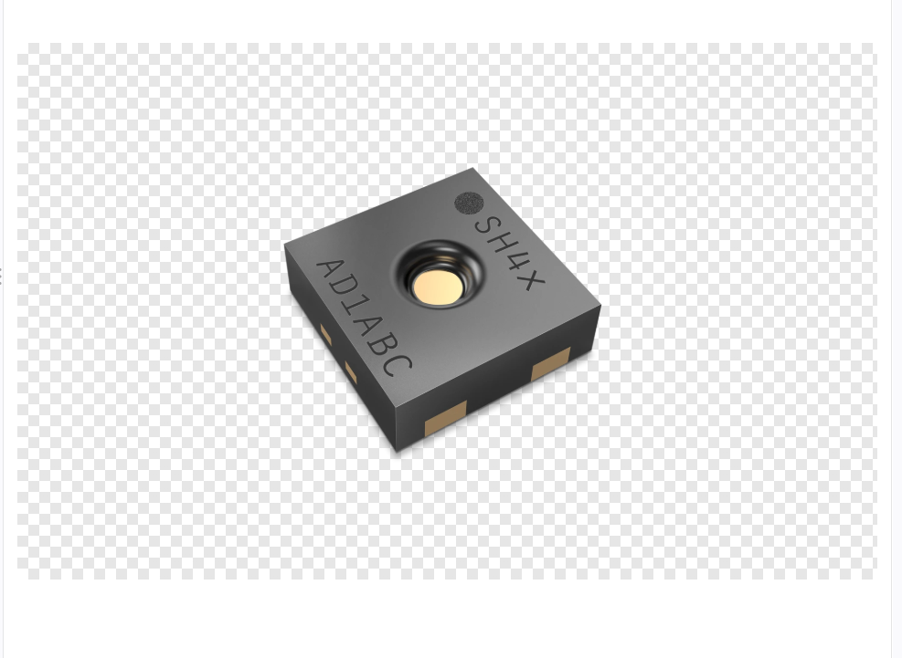
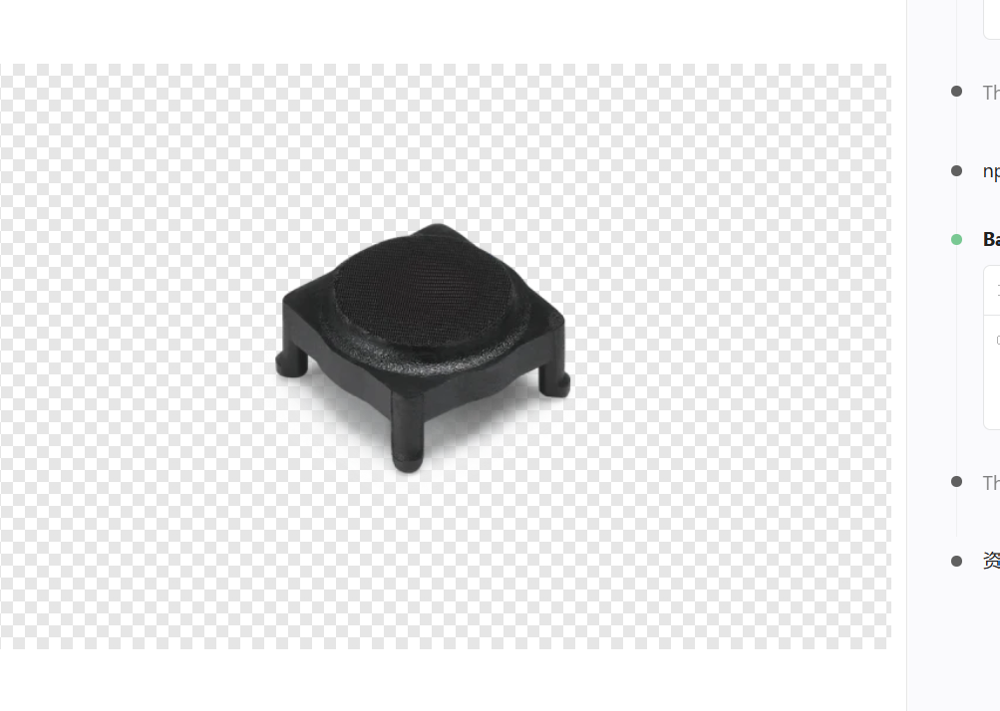
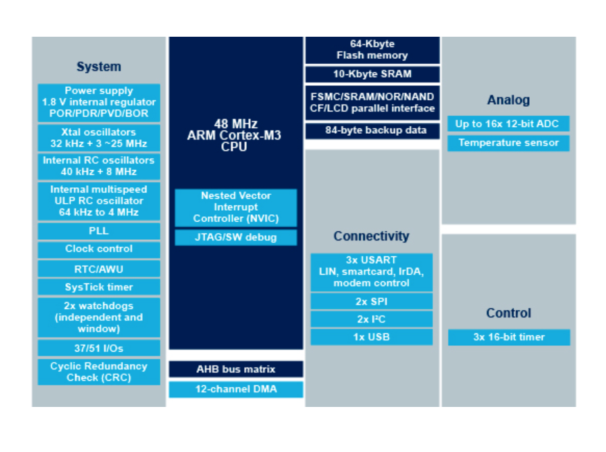
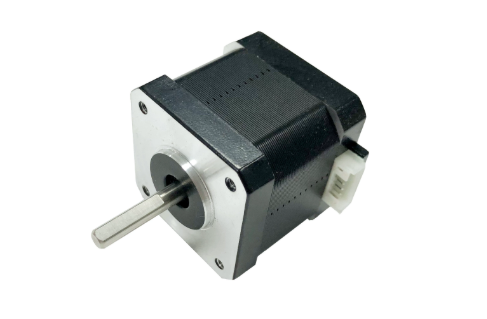
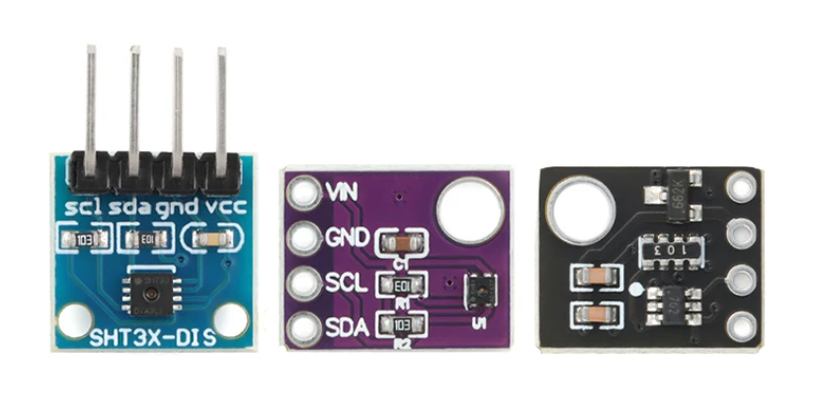

# 模块图片正反例与选图判定规范（用户提供的五张视觉样本）

> 本文件是 `technical-visual-assets` 的**强制视觉参照**。当任务涉及“模块实物图”、电机、传感器、主控板、通信模块或执行器产品图片时，先阅读此文件并**实际查看下列五张图片**，再评估网络候选图。图片是用户给出的筛选风格和主体层级案例，**不作为项目实际型号、项目实际装配或图片转载授权的证据**。
>
> **禁止误用**：前三张是针对“用于模块实物图”的反例，不等于这些图在所有技术语境下永远没有价值。第三张可在确有准确来源且芯片型号一致时作为*芯片内部功能框图*，但不能冒充整个项目的系统框架或模块实物图。后两张为**构图与对象层级**上的正例，不代表它们已经与任何具体项目的型号吻合或获得复用授权。

## 1. 五张实际样本

### 反例 1 — 只有裸传感器芯片/封装（不算完整传感器模块实物图）

- **实际看到**：单个小型封装器件，表面印有 `SH4X` 等标识；没有外部板卡、引出接口、安装/连接结构，也未呈现完整传感器模组。
- **为何不合格**：用户要的是**传感器模块**的完整产品外观，而不是焊接在模块上的感测芯片封装。不能因型号或系列文字相近就把“芯片”写成“模块”。
- **可用的严格例外**：若 MD/FACT 明确项目讨论的对象是*裸传感器芯片本身*，可另做“芯片封装图”候选并准确标注，**不得因此满足模块实物图的覆盖要求**。
- **正确搜索**：依据 MD/FACT 给出的准确型号找完整 breakout board / sensor module / 传感器整板产品照；如果项目未确认具体模块板型，标记“缺少实物板型依据”，不能随意选同芯片不同厂家的板。

### 反例 2 — 小型孤立配件/元器件特写（不算完整功能模块）

- **实际看到**：一个孤立的小型黑色部件特写，缺少与项目功能模块的完整组件、板卡、接口或系统角色关系的明确证据。**不能仅凭外观断言其确切型号或类别**。
- **为何不合格**：只呈现一个小部件，不说明它是否就是技术 MD 中的完整模块；不适合替代一个更大的功能组件或子系统。
- **正确搜索**：先确认 MD/FACT 中实际需要展示的是“完整按钮模组/蜂鸣器模组/执行器单元”还是某个独立成品，再以对应**整体对象**搜索。若本项目目标本来就是此完整独立产品，必须有明确证据、完整产品身份和用途核验，不能因“看起来像”而通过。

### 反例 3 — 芯片内部模块框图（不等于项目系统框架图、功能架构图或实物图）

- **实际看到**：含 CPU、存储、连接接口与外设等栏目的一张芯片级功能框图，内容集中在单个 MCU/芯片内部资源。
- **为何不合格**：用户要的“系统框架图”应展示当前真实项目的 MCU、传感器、通信、执行器及其实际连接/层次；“功能架构图”应展示项目提供的功能及从属关系。**芯片内部资源结构不是项目的系统或功能架构**；也不是实物照片。
- **严格例外**：若任务明确要求该**准确芯片型号**的“内部功能框图”，并能核验官方出处，可登记为额外参考技术图；不能占用四类必检图的名额，不能用与项目型号不符的框图凑数。

### 正例 1 — 完整步进电机产品外观（整体执行器）

- **实际看到**：完整步进电机本体，外壳/安装面、输出轴、连接接口等主要外观清楚可辨，没有把一个线圈、轴承、电阻或局部转子充当“电机”。
- **符合的筛图标准**：目标主体是**完整独立执行器产品**，整机展示完整、背景简单、无无关物件抢占主体。
- **仍需核实**：电机型号、尺寸、步距角、电流、版本等不得仅凭照片推测。只有和 MD/FACT 中真实电机型号/类型相符时，才可能批准为当前项目候选。

### 正例 2 — 完整传感器模块/转接小板实物（非裸芯片）

- **实际看到**：几块传感器板卡，能看见完整 PCB 轮廓、模块主体、焊盘/接线端、部分丝印和安装孔；中间搭载的传感器芯片只是模块的一部分。
- **符合的筛图标准**：每块可作为**完整传感器模块/转接小板**理解，而不是只展示板上芯片、电阻或某个焊盘。
- **注意**：图片同时包含多个板卡/版本时，实际选图最好选**与项目确定的准确模块版本一致的一块完整板**。若无法确定使用哪种板型，不能把多个变体统称为本项目实物。
- **仍需核实**：外观相似不证明型号一致；图片上的 `SHT3X-DIS` 等字样只是视觉线索，不等同于项目采用该板的证据。

## 2. 识别“正确对象层级”（强制）

| 目标层级 | 典型对象 | 作为模块实物图是否适用 |
|---|---|---|
| 项目整体/系统 | 整机机器人、监测装置、机箱内部系统 | 仅当目标确为整机图时可选；不替代每个核心模块 |
| 独立功能单元 | 完整步进电机、独立摄像头、驱动器、整套执行器单元 | **可适用**（前提是事实明确、匹配型号及用途） |
| 完整模组/整板 | STM32 开发板、SHTx 模组整板、RS-485 通信模块、驱动板 | **优先**（只展示当前项目真实使用的版本） |
| 裸芯片/局部组件 | 单独 IC 封装、PCB 焊接芯片、电阻、电容、接插件、板边角 | **不得代替完整模块**。可用于明确的“芯片封装/部件细节”单独任务 |
| 技术示意图 | 芯片内部框图、抽象网络拓扑、概念效果图 | **不是实物图**；是否可用取决于目标图类别与技术证据 |

**主要区分：功能边界而不是物理尺寸。** 电机虽然是单个物理部件，但它就是独立执行器整体，属于合格“完整功能单元”；传感器裸芯片可能很先进，但当项目所指是带 PCB 和接口的传感器模块时，裸芯片不能代表整套模块。

## 3. 每张候选模块实物图的七步验收（不可只看标题）

1. **对目标**：先写明 MD 章节、FACT ID、项目中的模块全称、原文型号/板型/厂家/版本（不存在就标 unknown）；判断当前要找的是整板、整机执行器还是独立成品，而非某个子器件。
2. **看全貌**：实际打开大图，判断**整个目标物**能否辨认，主体有没有被截断；正例 1/2 为整体层级参考。不能使用仅显示电阻/裸 IC/局部元件的反例 1/2。
3. **看对象**：图中是否是项目真实的完整功能对象？拒绝“芯片 vs 模组”“电机内部零件 vs 完整电机”“芯片内部框图 vs 项目系统框架”的层级混淆。
4. **查型号**：页面标题、厂商资料、可见型号或产品说明要交叉核对，若项目只写 MCU 芯片没有指定开发板，禁止从网上替用户挑一个看起来漂亮的整板。
5. **查用途**：图片是否为该模块的外观展示？示意结构图、参数表、包装盒、产品广告图、UI 截图不等于模块实物图；它们可以作为不同类型的候选。
6. **查质量与权利**：清晰度、主体占画面比例、背景、关键接口辨识度、原始页面、版权/许可证据；白底、透明背景**不构成不合格**，只有主体本身和内容相关性才重要。
7. **留下审计**：对每张候选填写“目标模块 → 图中主体 → 层级匹配/不匹配 → 完整性 → 精确型号 → 来源 → 许可 → 结论”，确认失败记录原因并继续检索，不能放一张无意义图满足进度。

## 4. 检索关键词建议（只使用正式 MD/FACT 已知的型号）

- 完整模块：`<完整型号> 模块 实物图 PCB 接口`、`<完整型号> breakout module board product photo`、`<完整型号> assembled module official`。
- 完整电机：`<完整型号> stepper motor full product photo`、`<完整型号> 步进电机 整机 实物 接口`。
- 反向过滤：优先避开 `bare chip`、`IC only`、`package drawing`、`schematic only`、`resistor`、`capacitor`、`pinout`、`internal block diagram`、`概念图`、`拆解图`，但**关键词排除不是审核**，最终以实际看到的原图为准。
- 未确认完整型号：查找线索可以，但不得下载或批准“看起来相近”的图，报告需要的型号证据。

## 5. 四类图的对象层级不能混用

- `system-framework`：项目整体子系统、物理/逻辑链路和交互边界；不是芯片内部外设框图。
- `functional-architecture`：项目级功能分类、功能子模块职责和从属关系；不是 MCU 内部资源表。
- `flowchart`：真实业务/数据/控制流程，必须有可证实步骤、分支和结果；不是漂亮但无语义的通用箭头图。
- `module-photo`：完整且型号相符的模块/整板/独立成品；不是局部 IC/电阻照片，也不能由芯片内部框图代替。

**重复同一错误图不因不同标签成为正确答案。** 本文件的正反例仅训练筛图观念；它们不是本项目可直接复用的业务图，不纳入任何项目 `VIS` 资产，也不能拿这些示例图片充数。

## 6. 图片再分发边界

这些示例来自用户本次上传的图片，仅用于理解选图标准。图片的原始作者和公开再分发许可尚未核实；向公开 GitHub 发布内含原图的版本前，应核对许可。若权限不明，保留本文件的文字判例并将图片放在本地私有资料区，不能默认为可公开转载。
