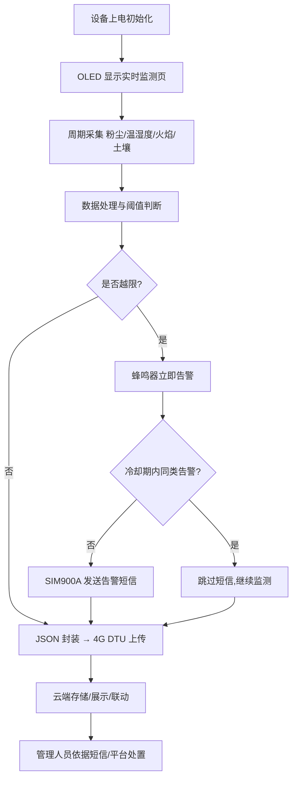
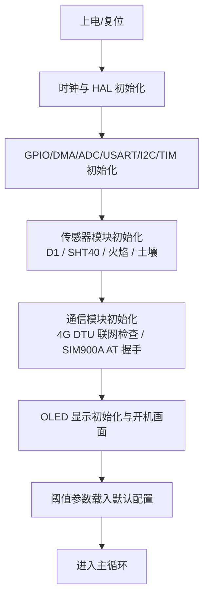
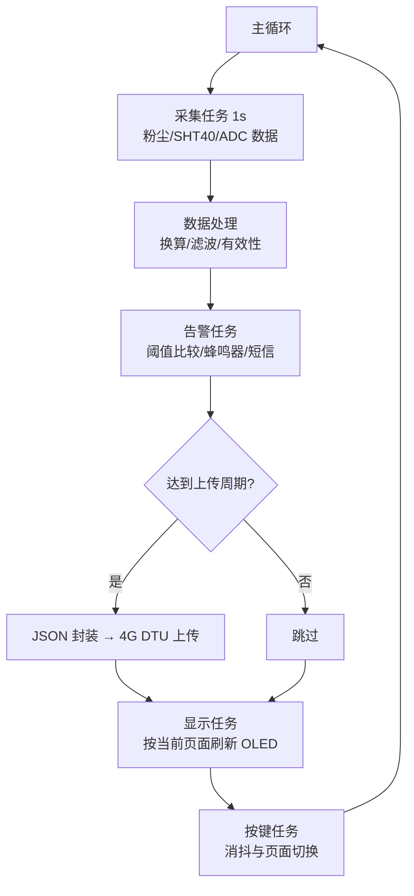
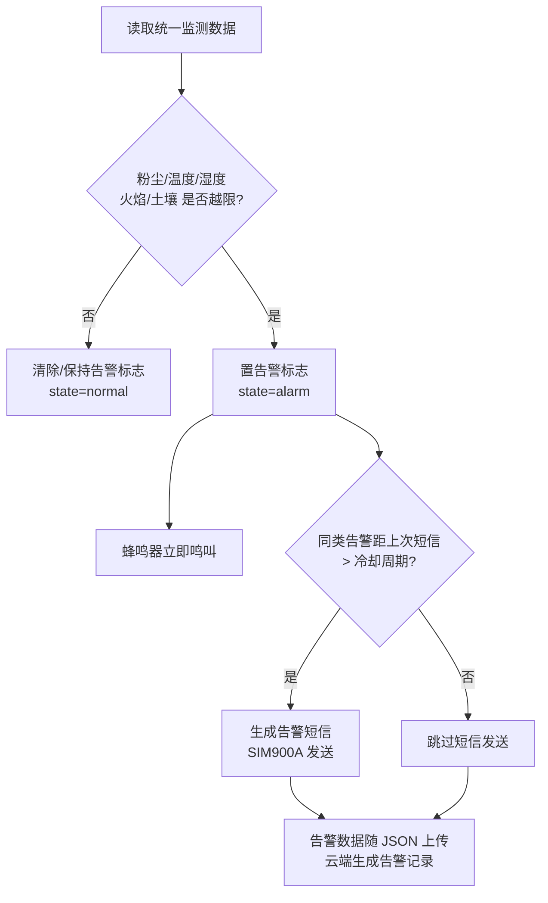
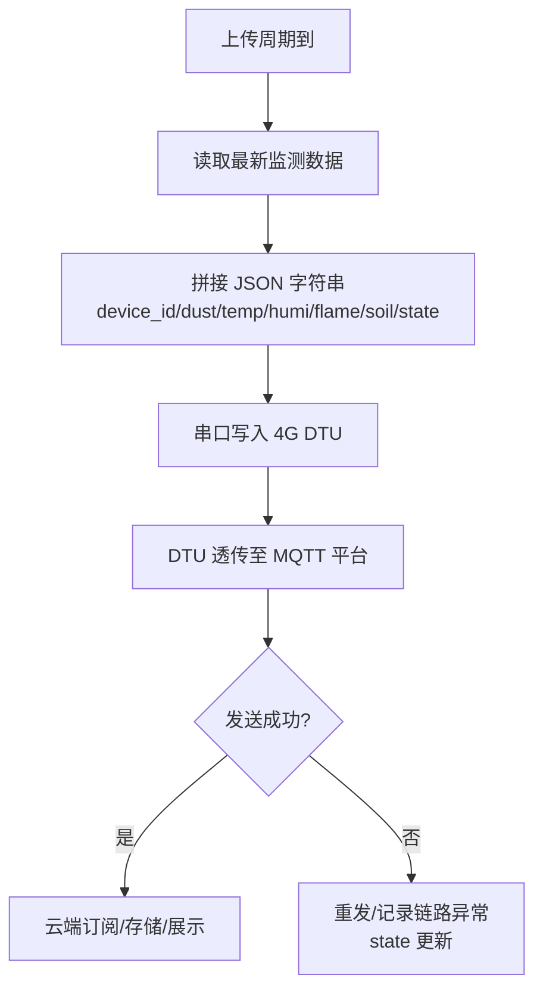
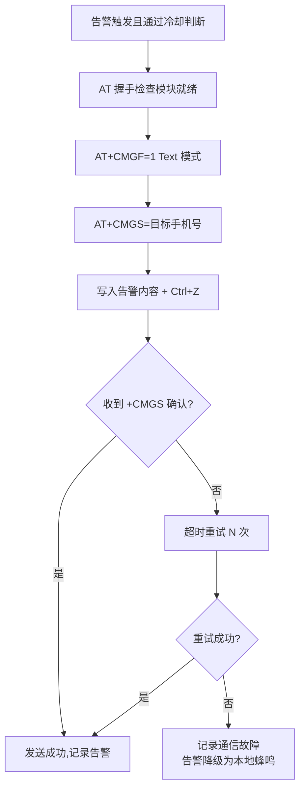

# 基于 STM32 与 4G 通信的胡杨林安全监测系统 — 技术文档

> **文档说明**：本文档在《基于 STM32 与 4G 通信的杨树林安全监测系统设计文档》基础上整理深化，
> 面向固件开发 / 系统集成工程师，覆盖系统功能、核心技术、模块组成与关键流程。
> **命名更正**：本系统监测对象为**胡杨**（*Populus euphratica*，胡杨林），全文统一使用"胡杨 / 胡杨林"。
>
> - 控制核心：STM32F103 微控制器
> - 通信方式：4G DTU 透传（MQTT/JSON）+ SIM900A GSM 短信告警
> - 文档版本：v1.0（2026-10-29）

---

## 目录

1. [项目概述](#1-项目概述)
2. [功能说明](#2-功能说明)
3. [系统总体架构](#3-系统总体架构)
4. [硬件平台与资源分配](#4-硬件平台与资源分配)
5. [核心技术解析](#5-核心技术解析)
6. [模块详解](#6-模块详解)
7. [关键流程](#7-关键流程)
8. [云端数据存储设计](#8-云端数据存储设计)
9. [系统测试方案](#9-系统测试方案)
10. [已知问题与改进建议](#10-已知问题与改进建议)
11. [附录：协议与配置速查](#11-附录协议与配置速查)

---

## 1. 项目概述

### 1.1 系统定位与应用场景

胡杨是我国西北干旱区荒漠河岸林的建群种，主要分布于塔里木河流域、河西走廊、额济纳绿洲等地，具有防风固沙、遏制土地荒漠化、维护绿洲生态安全的重要作用。胡杨林分布区气候干旱、夏季高温多风、林下枯落物易积累，加之旅游、放牧等人为活动，**火险等级高**；同时沙尘天气、土壤旱情、空气温湿度异常等环境因素也持续威胁胡杨林生态安全。传统人工巡护存在覆盖面小、响应滞后、通信困难等问题，难以实现大面积林区的连续监测。

本系统面向胡杨林安全监测场景，以**环境感知 + 远程告警**为核心，构建"感知层—控制层—通信层—应用层"的完整监测闭环：

- **感知层**：粉尘传感器（D1）、温湿度传感器（SHT40）、火焰传感器、土壤湿度传感器实时采集现场环境；
- **控制层**：STM32F103 完成数据采集转换、阈值判断、本地告警与显示交互；
- **通信层**：4G DTU 透传上传 JSON 数据至 MQTT 物联网平台，SIM900A 在异常时发送 GSM 告警短信；
- **应用层**：OLED 本地查看、云端平台数据订阅与可视化、管理人员短信接收与处置。

### 1.2 技术规格

| 项目 | 规格 |
|------|------|
| 主控 | STM32F103（Cortex-M3，最高 72MHz） |
| 粉尘传感器 | D1，串口（UART）输出颗粒物浓度 |
| 温湿度传感器 | SHT40，I2C 总线，±0.2℃ / ±1.8%RH 典型精度 |
| 火焰传感器 | 模拟量输出，ADC + DMA 连续采样 |
| 土壤湿度传感器 | 模拟量输出，ADC + DMA 连续采样 |
| 远程传输 | 4G DTU 串口透传，JSON 格式，MQTT / TCP |
| 短信告警 | SIM900A GSM 模块，Text 模式短信 |
| 本地显示 | OLED 显示屏（I2C），实时数据页 + 阈值参数页 |
| 本地交互 | 按键切换页面，蜂鸣器声告警 |
| 云端存储 | MQTT 平台对接，可入 MySQL / 时序数据库 |
| 数据管理 | 本地：内存变量与结构体；云端：三张核心数据表 |

---

## 2. 功能说明

### 2.1 功能总览

```
胡杨林安全监测系统
├── 环境监测功能
│   ├── 粉尘浓度采集（D1 串口）
│   ├── 温度 / 湿度采集（SHT40 I2C）
│   ├── 火焰状态检测（ADC + DMA）
│   └── 土壤湿度检测（ADC + DMA）
├── 本地显示功能
│   ├── 实时监测数据页（粉尘/温湿度/火焰/土壤湿度）
│   ├── 阈值参数页（各项告警阈值）
│   └── 按键页面切换
├── 远程传输功能
│   ├── JSON 数据封装
│   ├── 4G DTU 串口透传上传
│   └── MQTT 平台数据对接
├── 告警管理功能
│   ├── 多参数阈值比较判断
│   ├── 蜂鸣器本地声告警
│   ├── SIM900A 短信告警（双通道）
│   └── 告警冷却时间控制（防重复告警）
└── 系统管理功能
    ├── 外设与模块初始化（自检）
    ├── 主循环周期调度
    ├── 通信链路状态管理
    └── 运行状态管理（state 字段上报）
```

### 2.2 环境监测功能

| 监测项 | 传感器 | 采集方式 | 输出量 | 监测意义 |
|--------|--------|----------|--------|----------|
| 粉尘浓度 | D1 | UART 串口 | 颗粒物质量浓度 | 沙尘天气 / 空气质量监测 |
| 温度 | SHT40 | I2C | ℃ | 高温火险预警 |
| 湿度 | SHT40 | I2C | %RH | 干燥火险预警 |
| 火焰 | 火焰传感器 | ADC + DMA | 原始 ADC 值 | 林火**早期发现** |
| 土壤湿度 | 土壤湿度传感器 | ADC + DMA | 百分比 / ADC 值 | 旱情监测、火险辅助判断 |

行为规格：
- **周期采集**：各传感器按设定周期（默认 1s 量级）轮询 / 连续采样；
- **转换与校验**：原始值经协议解析（粉尘帧校验、SHT40 CRC）、线性映射换算为工程量；
- **有效性判断**：超量程 / 通信超时 / 数据异常时做默认值保护，避免脏数据进入告警与上传链路；
- **统一封装**：处理结果写入统一监测数据结构，供显示、告警、上传模块共享（单数据源）。

### 2.3 本地显示与交互功能

**页面一：实时监测页面**

```
┌──────────────────────────────┐
│ DUST: 0.128 mg/m3            │
│ TEMP: 28.5C   HUMI: 35.2%    │
│ FLAME: 860   (NO FIRE)       │
│ SOIL: 42%                    │
└──────────────────────────────┘
```

**页面二：阈值参数页面**

```
┌──────────────────────────────┐
│ DUST_TH : 0.50 mg/m3         │
│ TEMP_TH : 45.0C              │
│ HUMI_TH : 20.0%              │
│ FLAME_TH: 800                │
│ SOIL_TH : 30%                │
└──────────────────────────────┘
```

- 按键**短按切换**页面，切换只影响显示，不中断采集 / 上传 / 告警后台业务；
- 异常发生时**无论当前处于哪个页面**，告警逻辑立即执行（蜂鸣器 + 短信），可临时在显示上突出告警标识。

### 2.4 远程传输功能

- **数据封装**：将当前监测数据按约定 JSON 结构封装（含设备编号、各监测量、状态字）；
- **上传方式**：通过串口发送给 4G DTU，DTU 透传至 MQTT 平台或服务器；
- **上传周期**：定时触发（默认 30–60s，可配置）；
- **平台对接**：云端通过 MQTT 主题订阅 / 接口接收，可进一步持久化、可视化与告警联动；
- **兼容性**：JSON 跨平台易解析，便于接入各类物联网平台与 Web 组态。

### 2.5 告警管理功能

| 环节 | 行为 |
|------|------|
| 阈值判断 | 粉尘、温度、湿度、火焰、土壤湿度逐项与预设阈值比较（越上限 / 越下限） |
| 本地告警 | 越限**立即**驱动蜂鸣器鸣叫 |
| 远程告警 | 按告警类型组包短信，经 SIM900A 发送到预设管理人员手机号 |
| 冷却控制 | 同类告警在冷却周期（如 10 分钟）内**不重复发送**短信，防止告警风暴；蜂鸣器不受冷却限制 |
| 告警上报 | 告警数据随 JSON 上传（`state` 字段），云端可同步生成告警记录 |

双通道设计（本地声 + 远程短信）保证在网络平台不可达时仍具备直接告警能力。

### 2.6 系统管理功能

- **初始化管理**：上电依次完成 GPIO / DMA / ADC / USART / I2C / 定时器与各传感器、通信模块初始化；
- **调度管理**：主循环模块化调度采集、处理、判断、显示、上传各单元；
- **通信状态管理**：监测 4G DTU 链路与 SIM900A 就绪状态，上传内容携带设备状态（`state`）；
- **运行状态管理**：设备状态（正常 / 告警 / 故障）统一维护，供显示与上报。

### 2.7 典型使用场景与角色

| 角色 | 职责 |
|------|------|
| 监测终端设备 | 现场数据采集、处理、显示、上传、告警，系统核心执行主体 |
| 管理人员 | 查看平台上报数据、接收告警短信、现场检查与处置 |
| 维护人员 | 安装调试、阈值配置、传感器校准、通信链路维护与升级 |
| 平台管理员（云扩展） | 设备接入管理、数据存储查询、权限维护、远程告警联动 |

典型场景流程：



### 2.8 功能与实现映射

| 功能 | 实现模块 | 关键手段 | 状态 |
|------|----------|----------|------|
| 粉尘浓度采集 | 环境监测-粉尘子模块 | UART 协议解析 | ✅ |
| 温湿度采集 | 环境监测-温湿度子模块 | I2C + CRC 校验 | ✅ |
| 火焰检测 | 环境监测-火焰子模块 | ADC + DMA 连续采样 | ✅ |
| 土壤湿度检测 | 环境监测-土壤子模块 | ADC + DMA 连续采样 | ✅ |
| 数据换算与保护 | 数据处理模块 | 线性映射 / 滤波 / 默认值保护 | ✅ |
| 阈值告警 | 告警管理模块 | 多条件比较 + 蜂鸣器 | ✅ |
| 短信告警 | 告警管理 + SIM900A 模块 | AT 指令 Text 模式 | ✅ |
| 告警冷却 | 告警管理模块 | 时间戳冷却窗口 | ✅ |
| JSON 上传 | 4G 数据传输模块 | 串口透传 → MQTT | ✅ |
| OLED 两页面显示 | 本地显示模块 | 显存刷新 | ✅ |
| 页面切换 | 用户交互模块 | 按键短按 | ✅ |
| 云端存储 | 云平台 | 三张核心数据表 | 🔶 按平台部署 |

---

## 3. 系统总体架构

### 3.1 分层架构

```
┌─────────────────────────────────────────────────────────────┐
│  应用层   OLED 本地显示 │ 云平台订阅/可视化 │ 短信人工处置     │
├─────────────────────────────────────────────────────────────┤
│  通信层   4G DTU 透传(JSON/MQTT) │ SIM900A GSM 短信告警      │
├─────────────────────────────────────────────────────────────┤
│  控制层   STM32F103：采集调度 / 数据处理 / 阈值判断 /         │
│           显示驱动 / 按键交互 / 通信协调                      │
├─────────────────────────────────────────────────────────────┤
│  感知层   D1 粉尘(UART)  SHT40(I2C)  火焰(ADC)  土壤湿度(ADC) │
└─────────────────────────────────────────────────────────────┘
```

**分层职责**：
- 感知层只负责"产生原始数据"，屏蔽传感元件差异；
- 控制层是数据中枢，完成"原始数据 → 工程量 → 业务决策"的转换；
- 通信层把本地业务结果外送（常态数据走 4G，异常事件走短信），两条通道互为补充；
- 应用层面向人：本地看板 + 远程平台 + 短信触达。

### 3.2 运行时数据流

```
  ┌──────────┐  UART   ┌──┐
  │ D1 粉尘   │ ──────▶ │  │
  ├──────────┤  I2C   ┌┤  │   统一监测数据结构   ┌───────────┐
  │ SHT40    │ ──────▶ │S │ ───────────────────▶ │ OLED 显示 │ (页面1/2)
  ├──────────┤  ADC   ┌┤T │                      └───────────┘
  │ 火焰     │ ──────▶ │M │ ── 阈值比较 ──▶ 越限 ─┬─▶ 蜂鸣器本地告警
  ├──────────┤  ADC   ┌┤3 │                      └─▶ SIM900A 短信(冷却控制)
  │ 土壤湿度 │ ──────▶ │2 │
  └──────────┘        └┤F │ ── JSON 封装 ──▶ UART ──▶ 4G DTU ──▶ MQTT 平台
                        │1 │                                  ──▶ 云库存储/展示
                        └03┘
```

数据流转（对应上图）：
1. 传感器输出原始电信号 / 数字帧；
2. STM32 通过 UART、I2C 或 ADC+DMA 采集原始数据；
3. 系统解析、换算、有效性判断后写入统一监测数据结构；
4. 数据分三路使用：OLED 显示、阈值判断与告警控制、JSON 封装上传；
5. 云端完成持久化、展示与统计分析，告警事件同步入告警记录。

---

## 4. 硬件平台与资源分配

### 4.1 主控制器选型

| 方案 | 评估 | 结论 |
|------|------|------|
| 51 内核单片机 | 资源少、无 DMA、主频低，多串口并发吃力 | ✗ |
| ESP32 | 自带无线，但模拟采集与工业外设生态偏弱，本系统无线由 4G DTU 承担 | ✗ |
| 树莓派类 Linux 板 | 成本、功耗过高，野外长期运行可靠性不足 | ✗ |
| **STM32F103** | Cortex-M3、多 USART/I2C/ADC、DMA、定时器资源充足、HAL 生态成熟、成本低 | **✓ 选用** |

STM32F103 在本系统中承担：多传感器异构数据采集、数据转换与阈值判断、OLED/按键人机交互、两路通信（4G DTU / SIM900A）协调调度。

### 4.2 传感器选型与接口设计

| 传感器 | 接口 | 要点 |
|--------|------|------|
| **D1 粉尘传感器** | UART 串口 | 激光散射式，串口周期输出颗粒物浓度帧（帧头 + 数据 + 校验），固件侧用**协议解析状态机**逐字节解析；注意与调试串口的通道区分 |
| **SHT40 温湿度** | I2C | Sensirion 第四代器件，7-bit 地址 0x44；单次高精度测量命令（0xFD）+ CRC-8 校验；精度 ±0.2℃ / ±1.8%RH，适合野外温湿度监测 |
| **火焰传感器** | 模拟量 → ADC | 红外火焰探头，输出随火焰红外辐射强度变化的模拟电压；火灾**早期发现**的关键传感器，要求响应快、ADC 连续采样 |
| **土壤湿度传感器** | 模拟量 → ADC | 电容式探头，输出与土壤含水率相关的模拟电压；反映旱情与火险辅助判据 |

**ADC + DMA 设计**：火焰与土壤湿度两路模拟量由 ADC 多通道扫描采集，DMA 循环搬运到内存缓冲，CPU 零干预，保证采样连续性并降低负荷；固件侧再做滑动平均滤波。

### 4.3 通信模块设计

**4G DTU 透传模块**
- 串口透传方式接入 STM32，DTU 内部完成 4G 蜯窝拨号与协议栈；
- 设备侧只需按约定周期写入 JSON 字符串，DTU 透明转发至 MQTT 平台 / 服务器；
- 部署简便，适合林区缺乏有线网络、布线困难的野外场景；
- 需关注：心跳保活、断线自动重连、信号弱区的重传策略。

**SIM900A GSM 短信模块**
- 双频 GSM 模块，AT 指令控制，Text 模式短信；
- 作为**独立告警通道**：监测数据越限时直接向预设手机号发送告警短信；
- 与 4G 上传互为补充——即使物联网平台不可达，告警仍可触达管理人员；
- 注意：SIM900A 为 2G 制式，需评估当地 2G 网络可用性（见第 10 章）。

### 4.4 人机交互与外围电路

| 部件 | 说明 |
|------|------|
| OLED 显示屏 | I2C 接口，128×64 点阵，显示实时数据页与阈值参数页 |
| 按键 | 短按切换显示页面（轮询或外部中断检测 + 消抖） |
| 蜂鸣器 | GPIO 驱动有源蜂鸣器，越限**立即**声告警 |
| 电源 | 12V 输入经 DC-DC 转 5V/3.3V，野外部署可扩展太阳能 + 锂电池（见展望） |

### 4.5 资源分配（典型设计，可按实际硬件调整）

| 资源 | 分配 | 用途 |
|------|------|------|
| USART1 | D1 粉尘传感器 | 粉尘数据帧接收 |
| USART2 | 4G DTU | JSON 数据上传 |
| USART3 | SIM900A | AT 指令与短信收发 |
| I2C1 | SHT40（可与 OLED 共总线） | 温湿度采集 / 显示 |
| ADC1 + DMA | CHx（火焰）、CHy（土壤湿度） | 模拟量连续采样 |
| GPIO | 按键输入 ×1、蜂鸣器输出 ×1 | 交互与本地告警 |
| TIMx | 基本定时 / 看门狗 | 周期任务时基 |

> 三路串口恰好对应三类串口设备（粉尘 / 4G DTU / SIM900A），是本方案的资源匹配关键点；若引脚或通道冲突，可将粉尘传感器换用软件串口或扩展 UART4。

---

## 5. 核心技术解析

### 5.1 多源异构传感器数据采集技术

系统最大特点是**三种通信方式并行**：

| 方式 | 对象 | 技术要点 |
|------|------|----------|
| UART 协议解析 | D1 粉尘 | 逐字节状态机解析（找帧头 → 收数据 → 校验 → 提取），容忍粘包 / 断帧 |
| I2C + CRC | SHT40 | 单次测量命令 → 等待测量完成 → 读温湿度原始值 → CRC-8 校验 → 转换公式换算 |
| ADC + DMA | 火焰、土壤 | ADC 扫描模式 + DMA 循环模式连续采样，软件滑动平均滤波，CPU 零拷贝负担 |

异构数据在**数据处理模块**统一为同一数据结构，屏蔽底层差异，上层业务（显示 / 告警 / 上传）只面向统一结构编程。

### 5.2 数据处理与工程量换算

- **ADC 线性映射**：`工程量 = (ADC原始值 - 零点) / 满量程 × 量程`，土壤湿度映射为 0–100%，火焰保留原始 ADC 值并辅以越限标志；
- **滤波**：滑动平均 / 中值滤波抑制传感器噪声与瞬时扰动，避免误告警；
- **有效性保护**：对超量程、通信超时、校验失败的数据做默认值保护（保留上一次有效值或标记无效），防止脏数据污染告警判断与云端数据库；
- **结构化输出**：所有监测量进入统一监测数据结构（内存变量 / 结构体管理，本地无需关系型数据库）。

### 5.3 阈值告警引擎

```
任一监测量越限
  ├─▶ 置告警标志（alarm_type / alarm_value）
  ├─▶ 蜂鸣器立即鸣叫（不受冷却限制）
  ├─▶ 冷却判断：距同类告警上次发短信 > 冷却周期？
  │      ├─ 是 ─▶ 组包告警短信 → SIM900A 发送
  │      └─ 否 ─▶ 跳过短信（防告警风暴）
  └─▶ state 置告警态 → 随 JSON 上传 → 云端告警联动
```

设计要点：
- **多条件独立判断**：粉尘、温度、湿度、火焰、土壤各自与阈值比较，互不短路；
- **双通道告警**：本地声（即时）+ 远程短信（触达），可靠性互补；
- **冷却机制**：以时间戳维护每类告警的发送窗口，避免持续越限时短信轰炸；
- 阈值作为可配置参数（默认值见附录），支持现场按季节 / 火险等级调整。

### 5.4 JSON 数据封装与 4G 透传上传

JSON 结构（示例）：

```json
{
  "device_id": "HY-001",
  "timestamp": "2026-10-29T14:30:00+08:00",
  "dust": 0.128,
  "temperature": 28.5,
  "humidity": 35.2,
  "flame_adc": 860,
  "flame_alarm": 0,
  "soil_moisture": 42,
  "state": "normal"
}
```

- 按上传周期（默认 30–60s）读取最新监测数据 → 定长/ snprintf 拼接 JSON → 串口写给 4G DTU；
- DTU 透传至 MQTT 平台（主题按 `device/<device_id>/data` 约定），云端订阅解析；
- JSON 便于云端解析与跨平台兼容，是设备端与平台间的通用数据契约；
- 可靠性设计：发送后检查 DTU 应答 / 链路状态，失败进重发队列；`state` 字段承载设备状态供平台侧监控。

### 5.5 GSM 短信告警链路（AT 指令）

短信发送时序（Text 模式）：

```
AT                  → OK          (握手)
ATE0                → OK          (关回显)
AT+CMGF=1           → OK          (Text 模式)
AT+CMGS="138xxxxxxxx"  → '>'
  <短信内容>  +  0x1A(Ctrl+Z)  → +CMGS <n>  (发送成功)
失败 → 重试 N 次 → 记录通信故障
```

- 短信内容模板：`【胡杨林监测】设备HY-001 14:30:01 检测到火焰异常(ADC=860,阈值=800)，请及时处置。`（见附录）；
- 发送前查询模块就绪（`AT` 握手），发送后等待 `+CMGS` 确认，超时重试；
- 短信是"事件驱动"链路，只在告警触发且通过冷却判断后占用，平时不消耗资费。

### 5.6 主循环协作式调度

系统采用裸机主循环 + 周期节流的协作式调度（无 RTOS）：

| 任务 | 周期 | 职责 |
|------|------|------|
| 采集任务 | 1s | 读取粉尘 / SHT40，触发 ADC 缓冲换算 |
| 处理任务 | 随采集 | 换算、滤波、有效性判断、写统一结构 |
| 告警任务 | 100ms–1s | 阈值比较、蜂鸣器、短信冷却判断 |
| 上传任务 | 30–60s | JSON 封装、DTU 发送 |
| 显示任务 | 500ms–1s | 按当前页面刷新 OLED |
| 按键任务 | 20ms | 消抖扫描、页面切换 |

优点：实现简单、确定性好、资源占用小；约束：各任务须非阻塞（AT 等待等耗时操作需超时化 / 状态机化）。

### 5.7 云端对接技术

- 设备 → DTU → MQTT 平台 → 订阅端 / Web 可视化 → 时序库 / MySQL 持久化；
- 平台侧可扩展设备鉴权（Topic 鉴权、ClientID/密码）、TLS 加密传输；
- 云端告警联动：订阅端解析 `state`/`flame_alarm` 字段生成告警记录并推送（邮件 / APP / 大屏）。

---

## 6. 模块详解

### 6.1 环境监测模块（核心业务基础）

- **职责**：实时获取胡杨林环境状态，为告警、显示、上传提供数据来源。
- **子模块**：
  - 粉尘采集子模块：UART 帧解析 → 浓度值；
  - 温湿度采集子模块：SHT40 驱动 → ℃ / %RH；
  - 火焰采集子模块：ADC+DMA → 原始值 + 越限标志；
  - 土壤湿度采集子模块：ADC+DMA → 百分比。
- **要点**：周期性采集 + 转换 + 有效性判断，输出统一数据结构；任何子模块故障不应拖垮其他采集通道（隔离性）。

### 6.2 数据处理模块（数据中枢）

- **职责**：位于采集与业务之间，完成 ADC 原始值采集、电压换算、百分比计算、阈值比较前处理、数据封装。
- **要点**：不同传感器不同采集方式 → 线性映射统一工程量；无效数据默认保护；输出格式统一供告警与上传模块调用。

### 6.3 告警管理模块

- **职责**：阈值比较、蜂鸣器本地报警、告警短信生成、短信冷却控制。
- **依赖**：环境监测模块（实时数据）、SIM900A 模块（短信通道）、蜂鸣器模块（本地声）。
- **要点**：异常出现时**立即**开蜂鸣器；短信按冷却周期限频；告警类型 / 触发值 / 阈值随记录留存（云端 alarm_record）。

### 6.4 4G 数据传输模块

- **职责**：JSON 封装、上传周期控制、串口透传发送、MQTT 对接。
- **依赖**：环境监测模块的最新数据。
- **要点**：定时触发上传；不参与阈值判断但上报含 `state` 的完整状态；传输失败的重发与链路状态管理是可靠性关键。

### 6.5 SIM900A 短信模块

- **职责**：AT 初始化、短信组包与发送、结果确认与重试。
- **要点**：Text 模式 + Ctrl+Z 结束符；发送确认（`+CMGS`）与超时重试；与告警模块解耦（提供"发送一条短信"接口即可）。

### 6.6 本地显示模块（OLED）

- **职责**：实时监测数据页 / 阈值参数页的渲染与刷新。
- **要点**：从采集模块与告警模块取数；页面切换只改显示状态，不影响后台；告警时可临时叠加告警标识；刷新周期 500ms–1s。

### 6.7 用户交互模块（按键）

- **职责**：按键输入检测、页面切换驱动、状态与阈值查看入口。
- **要点**：短按切换页面；消抖处理（20ms 轮询或中断 + 软消抖）；交互与后台业务解耦——页面切换不中断上传与告警。

### 6.8 系统控制模块（管理模块）

- **职责**：外设初始化、主循环调度、DMA/串口/I2C 驱动管理，以及设备运行状态、告警状态、通信状态、参数配置查看等运行管理职能。
- **要点**：上电初始化序列明确（先外设后模块、先通信后业务）；调度周期表驱动；通信异常（DTU 掉线、SIM 卡失效）应反映到 `state` 并上报。

---

## 7. 关键流程

### 7.1 系统上电启动流程



### 7.2 主循环调度流程



### 7.3 数据采集与处理流程

```
原始信号 → 采集接口(UART/I2C/ADC+DMA)
        → 协议解析 / CRC 校验 / 数字滤波
        → 工程量换算(线性映射)
        → 有效性判断(超量程/超时→默认保护)
        → 写入统一监测数据结构
        → 供显示 / 告警 / 上传 三路消费
```

### 7.4 阈值判断与告警流程



### 7.5 JSON 封装与 4G 上传流程



### 7.6 SIM900A 短信发送流程



### 7.7 页面切换交互流程

```
按键短按 → 消抖确认(20ms) → 页面取反(实时页↔阈值页)
        → 显示任务下一拍按新页面刷新
        → 后台采集/上传/告警不受影响
异常发生 → 告警逻辑立即执行(无论当前页面)
```

---

## 8. 云端数据存储设计

本地终端无传统关系型数据库（内存变量 + 结构体实时管理），云端按三张核心表持久化：

### 8.1 核心数据表

**设备信息表 `device_info`**

| 字段 | 含义 |
|------|------|
| device_id | 设备唯一编号 |
| device_name | 设备名称 |
| install_location | 安装位置（胡杨林监测点） |
| device_status | 设备状态 |
| created_time | 接入时间 |

**环境监测数据表 `sensor_data`**

| 字段 | 含义 |
|------|------|
| id | 主键 |
| device_id | 设备编号（外键） |
| upload_time | 上传时间 |
| dust | 粉尘浓度 |
| temperature | 温度 |
| humidity | 湿度 |
| flame_adc | 火焰传感器原始值 |
| soil_moist | 土壤湿度 |
| state | 设备状态 |

**告警记录表 `alarm_record`**

| 字段 | 含义 |
|------|------|
| alarm_id | 告警编号 |
| device_id | 设备编号（外键） |
| alarm_type | 告警类型（粉尘/温度/湿度/火焰/土壤） |
| alarm_value | 告警触发值 |
| threshold_value | 越限阈值 |
| alarm_time | 告警时间 |
| alarm_status | 处理状态 |
| handler | 处理人 |

### 8.2 表间关系

```
device_info 1 ──── N sensor_data      (一设备多条监测数据)
device_info 1 ──── N alarm_record     (一设备多条告警记录)
sensor_data  ────→ alarm_record       (告警源于某时刻监测结果)
```

---

## 9. 系统测试方案

### 9.1 测试环境

- 实验室模拟环境（打火机模拟火源、加热/加湿模拟温湿度变化、吹尘模拟粉尘）+ 校园/林地试验点；
- 工具：串口调试助手、MQTT 客户端（如 MQTTX）、手机短信接收、标准温湿度计、万用表。

### 9.2 功能测试用例

| 编号 | 测试项 | 操作 | 预期结果 |
|------|--------|------|----------|
| T01 | 粉尘采集 | 粉尘源靠近传感器 | OLED/云端粉尘值上升，变化合理 |
| T02 | 温湿度采集 | 加热/加湿传感器 | 温湿度值与标准表偏差在精度范围 |
| T03 | 火焰检测 | 火焰靠近探头 | flame_adc 越限，立即蜂鸣 + 短信 |
| T04 | 土壤湿度 | 干/湿土壤切换 | 百分比对应变化 |
| T05 | 页面切换 | 短按按键 | 实时页/阈值页互切，后台不中断 |
| T06 | 阈值页显示 | 切至阈值页 | 五项阈值正确显示 |
| T07 | JSON 上传 | 等待上传周期 | MQTT 端收到合法 JSON，字段完整 |
| T08 | 短信告警 | 制造越限 | 预设手机收到含类型/值/阈值的短信 |
| T09 | 告警冷却 | 持续越限 10 分钟 | 冷却期内仅 1 条短信，蜂鸣器持续 |
| T10 | 数据保护 | 传感器拔除 | 上报无效标记/保持值，不误告警 |

### 9.3 通信与告警可靠性测试

- **上传成功率**：连续 200 次上传统计成功率（目标 ≥98%），记录弱信号场景表现；
- **短信送达延迟**：从越限到短信接收的时间（目标 <30s，不含 GSM 注册波动）；
- **冷却有效性**：验证同类告警冷却窗口内不重复发送；
- **断电恢复**：断电重启后系统自动恢复采集/上传/告警全功能。

### 9.4 结果分析（预期）

系统功能运行稳定，采集数据准确、上传可靠、告警及时，双通道告警与冷却机制符合设计目标；4G 弱信号区的重传策略与 2G 网络可用性是现场部署需重点验证的两项。

---

## 10. 已知问题与改进建议

| # | 问题 / 风险 | 影响 | 建议 |
|---|------------|------|------|
| 1 | **SIM900A 为 2G 制式**，面临 2G 网络退网 / 停服风险 | 短信告警通道失效 | 评估当地 2G 可用性；预留 4G Cat-1 / LTE 模块升级路径 |
| 2 | 供电依赖市电，野外取电困难 | 限制部署位置 | 太阳能 + 锂电池供电与低功耗管理（休眠/唤醒采集） |
| 3 | 阈值固定，季节/火险等级适应性弱 | 误报/漏报 | 阈值在线可配置（按键/云端下发），支持多套预案 |
| 4 | 无 RTC 时间同步，timestamp 依赖平台 | 告警时间不准 | 增加 NTP/北斗/GPS 对时或 RTC 芯片 |
| 5 | DTU 断线后上传数据丢失 | 数据缺口 | 断线缓存重发队列 + 心跳检测 + 自动重连 |
| 6 | JSON 无鉴权/校验，明文传输 | 可被伪造/窃听 | 平台侧 Topic 鉴权 + TLS；设备侧加签名/序号 |
| 7 | 传感器未标定，长期漂移 | 数据失真 | 定期校准流程 + 软件校准系数 |
| 8 | 单点监测，无组网能力 | 覆盖有限 | 扩展 LoRa/NB-IoT 自组网多节点覆盖 |

**后续路线**：低功耗与太阳能供电 → 多传感器组网 → 摄像头图像识别火情 → 云端 Web 可视化与大数据分析 → 边缘侧火险等级预判。

---

## 11. 附录：协议与配置速查

### 11.1 JSON 上报格式

```json
{
  "device_id": "HY-001",
  "timestamp": "2026-10-29T14:30:00+08:00",
  "dust": 0.128,
  "temperature": 28.5,
  "humidity": 35.2,
  "flame_adc": 860,
  "flame_alarm": 0,
  "soil_moisture": 42,
  "state": "normal"
}
```

### 11.2 告警短信模板

| 类型 | 模板示例 |
|------|----------|
| 火焰 | `【胡杨林监测】设备HY-001 14:30:01 检测到火焰异常(ADC=860,阈值=800)，请及时处置。` |
| 高温 | `【胡杨林监测】设备HY-001 14:30:01 温度超限(46.5℃>45.0℃)，请注意火险。` |
| 干燥 | `【胡杨林监测】设备HY-001 14:30:01 湿度过低(18.2%<20.0%)，请注意防火。` |
| 粉尘 | `【胡杨林监测】设备HY-001 14:30:01 粉尘浓度超限(0.62>0.50 mg/m3)。` |
| 旱情 | `【胡杨林监测】设备HY-001 14:30:01 土壤湿度过低(25%<30%)。` |

### 11.3 SIM900A AT 指令速查

| 指令 | 作用 | 应答 |
|------|------|------|
| `AT` | 握手 | `OK` |
| `ATE0` | 关闭回显 | `OK` |
| `AT+CMGF=1` | Text 模式 | `OK` |
| `AT+CMGS="号码"` | 开始发短信 | `>` |
| 内容 + `0x1A` | 发送 | `+CMGS <n>` |
| `AT+CSQ` | 信号查询 | `+CSQ: xx,yy` |

### 11.4 默认阈值配置表

| 参数 | 默认阈值 | 方向 | 说明 |
|------|----------|------|------|
| 粉尘浓度 | 0.50 mg/m³ | 越上限 | 沙尘 / 空气质量 |
| 温度 | 45.0 ℃ | 越上限 | 高温火险 |
| 湿度 | 20.0 %RH | 越下限 | 干燥火险 |
| 火焰 ADC | 800 | 越上限 | 林火告警（立即） |
| 土壤湿度 | 30 % | 越下限 | 旱情告警 |
| 短信冷却 | 10 分钟 | — | 同类告警发送间隔 |
| 上传周期 | 60 秒 | — | JSON 上报间隔 |

> 以上为设计默认值，需按现场标定与火险等级实际配置。

---

> **相关文档**：
> - 《基于 STM32 与 4G 通信的杨树林安全监测系统设计文档》（原始设计蓝本，物种命名应更正为**胡杨林**）
> - 各传感器 / 模块数据手册：SHT40 Datasheet、SIM900A AT 手册、4G DTU 配置手册
